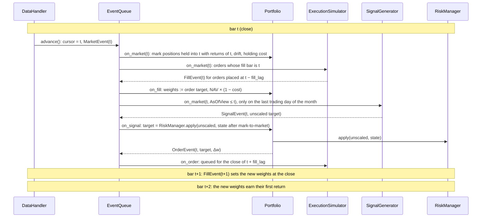

# Design

Hypothetical backtests only, not investment advice.

## Overview

momlab is a small event-driven backtest engine. Its only job is to make look-ahead impossible by
construction, and to say so in tests. Data flows one way:

```
Ken French zips ──kenfrench.py──► data/processed/*.parquet ──DataHandler──► AsOfView (rows ≤ t)
                                                                              │
          ┌───────────────────────────── engine.run_with (EventQueue) ────────┤
          │                                                                   ▼
   Portfolio ◄── FillEvent ◄── ExecutionSimulator ◄── OrderEvent ◄── Portfolio.on_signal ◄── SignalEvent ◄── signals.rules
   (weights, cash at RF,         (fill at t+fill_lag,                (RiskManager:
    NAV, drift)                   CostModel)                          vol target, caps)
          │
          ▼
   RunResult (daily gross / costs / net / turnover / NAV, weights, orders, fills)
          │
          ├──► analytics (metrics, bootstrap, factor regression)
          └──► ledger.jsonl (one hash-chained line per trial, when log=True)
```

- **One clock:** trading days of the Ken French daily panel. Monthly signals are compounded from
  daily returns inside the view, so there is a single data source.
- **One accessor:** strategy code only ever receives an `AsOfView`. It never receives the
  handler, a DataFrame or the full array.
- **Independent oracle:** `oracle.py` re-implements the same conventions in vectorised form and
  imports no engine, portfolio, execution, handler, signal or risk code.

## Timing contract

PLAN §3.2, as built in `engine.run_with` (E-6). Bar `t` is the close of a trading day.



### Conventions (DECISIONS 010)

| Quantity | Formula |
|---|---|
| Day-t gross return | `R = Σ w_i r_i + (1 − Σ w_i)·rf` with weights held into t |
| Growth, drift | `g = 1 + R − h` (h = holding cost); `w_i ← w_i (1 + r_i) / g` |
| Fill | trade from drifted weights to the order's target at the close of t + fill_lag; NAV × (1 − cost) |
| Net return | `NAV_t / NAV_{t−1} − 1` (gross, holding and trading costs together) |
| Missing return on a held asset | earns 0 that day and is counted in `n_missing_held` |
| 12-1 window | months M−11 … M−1 for the rebalance at the end of month M |
| B4 leverage | `min(0.10 / σ, 2.0)`, σ = sd (ddof 1) of the last 126 daily returns of the unscaled strategy × √252; 0 during warm-up |

### Invariants and the tests that guard them

| Invariant | Enforced by | Test |
|---|---|---|
| Strategy code sees rows ≤ t only | `AsOfView` (slots, name-mangled array, integer cursor) raises `LookAheadError` | `test_cursor_and_view_bounds`, `test_no_dataframe_attribute` |
| Characteristics are used only once published | `AsOfView.field` drops rows with `available_at > t` | `test_field_drops_rows_not_yet_available` |
| Decisions up to t do not depend on data after t | the whole design | `test_poisoned_future` (NaN and +1000% after t), `test_daily_results_up_to_t_unchanged_by_nan_future` |
| `fill_lag ≥ 1` | pydantic validator and `ExecutionSimulator` | `test_fill_lag_zero_raises`, `test_fill_lag_must_be_positive` |
| Order at t fills at the close of t+1 and earns from t+2 | `ExecutionSimulator` counts bars | `test_order_at_t_fills_at_t_plus_1_and_earns_from_t_plus_2`, `test_fill_lag_two` |
| Events in time order; a fill after its order | `EventQueue` | `test_out_of_order_event_raises`, `test_fill_at_or_before_order_raises`, `test_fill_for_unknown_order_raises` |
| Turnover and costs from drifted weights | `Portfolio.turnover`, `ExecutionSimulator` | `test_turnover_from_drifted_weights`, `test_fill_trades_to_target_from_drifted_weights_and_charges_cost` |
| Returns are never forward-filled | NaN month → NaN score → asset not held | `test_score_needs_full_history_and_excludes_missing`, `test_missing_returns_on_held_assets_are_counted` |
| Rebalance only on the last trading day of a month | `TradingCalendar` | `test_signal_only_on_rebalance_dates`, `test_month_end_on_holiday`, `test_incomplete_last_month_is_dropped` |
| Test period (2006-01 on) locked | `DataHandler` drops rows unless `MOMLAB_UNLOCK_TEST=1` and tag `prereg-v2` | `test_vault_locked` |
| Engine accounting is exact | hand-worked fixture and independent oracle | `test_hand_computed_trades_3x6` (1e-12), `test_engine_equals_oracle_synthetic` (1e-10), `test_oracle_has_no_engine_imports` |
| Every trial is recorded and cannot be rewritten | `Ledger` hash chain and head record | `test_ledger_append_only`, `test_ledger_api_has_no_update_or_delete` |

## Module interfaces

| Module | Public interface |
|---|---|
| `config.py` | `RunConfig` (pydantic, frozen fields, `fill_lag ≥ 1`), `load_config(*yaml_paths)`, `config_hash()` |
| `events.py`, `queue.py` | frozen `MarketEvent`, `SignalEvent`, `OrderEvent`, `FillEvent`; `EventQueue` |
| `data/handler.py` | `DataHandler(dates, assets, returns, rf=…, fields=…)`, `.from_processed(weighting, start, end)`, `advance()`, `view() -> AsOfView` |
| `data/calendar.py` | `TradingCalendar(days)`, `month_end_rebalance_dates()`, `nth_trading_day(n)` |
| `portfolio.py` | `Portfolio.on_market`, `on_signal`, `on_fill`, `turnover`; `RiskManager` protocol |
| `execution.py`, `costs.py` | `ExecutionSimulator(fill_lag, cost_model)`; `CostModel` protocol, `FlatBps`, `SpreadImpactBorrow` |
| `signals/rules.py`, `risk.py` | `MomentumSignal`, `EqualWeightSignal`; `VolTargetRisk`, `CapsRisk` |
| `engine.py` | `run(config, handler=None, *, log=False, ledger=None, notes="") -> RunResult`, `run_with(...)` |
| `oracle.py` | `run_oracle(config, dates, returns, rf) -> DataFrame` (FlatBps, no caps) |
| `analytics/` | `metrics.performance(returns, rf, freq, turnover)`, `sharpe`, `max_drawdown`, `newey_west_t`, `lo_adjusted_sharpe`, …; `bootstrap.stationary_bootstrap`, `confidence_interval`; `factors.factor_regression` |
| `ledger.py` | `Ledger(path).append(entry)`, `.read()`, `.verify()`; `make_entry(config, result, rf, manifest_hash=…)` |

## Cost model

Costs are fractions of NAV (1 bp = 0.0001) and are never negative.

- **`FlatBps(bps)`** (industry leg): `bps × 1e-4 × Σ|Δw|` at each fill. Swept over
  {0, 5, 10, 25, 50} bp.
- **`SpreadImpactBorrow`** (ETF leg): `Σ|Δw_i| × (half_spread_i + commission + k σ_i
  sqrt(|Δw_i| × AUM / ADV_i))`, with σ_i taken from the last 63 daily returns in the view.
  Holding cost: `borrow / 252 × Σ max(−w_i, 0)` charged daily.

## Performance profile

Copied from `reports/profile.md` (`uv run python tasks.py profile`).

Generated by `scripts/profile_engine.py` (task V-5, PLAN §3.7). Synthetic panel with the
real shape: 49 assets × 26155 bars (the weekdays of 1926-07-01 … 2026-09-30),
dated to end 2005-12-30 (C16). B3 and B4 at 10 bp. Hypothetical backtests.

Machine: Windows-11-10.0.26300-SP0, Python 3.13.15, Intel64 Family 6 Model 186 Stepping 2, GenuineIntel.

| Strategy | Bars | Wall time (s) | Bars per second | Peak memory (MiB, tracemalloc) |
|---|---|---|---|---|
| B3 | 26155 | 11.15 | 2,346 | 64.9 |
| B4 | 26155 | 10.45 | 2,504 | 64.9 |

Target < 30 s per full backtest: **met**.

### Time share per component (pyinstrument, 1 ms sampling)

Self time is attributed to the nearest momlab module on the call stack, so NumPy and
pandas work done for the portfolio counts as portfolio time.

| Component | B3 | B4 |
|---|---|---|
| portfolio | 50.2% | 50.8% |
| engine loop | 35.7% | 34.1% |
| data handler / AsOfView | 10.0% | 10.0% |
| events and queue | 1.6% | 1.7% |
| signals | 1.0% | 1.1% |
| risk | 0.0% | 0.9% |
| calendar | 0.7% | 0.7% |
| execution | 0.7% | 0.5% |
| costs | 0.1% | 0.1% |
| outside momlab | 0.0% | 0.0% |
| other momlab | 0.0% | 0.0% |

Call tree for B4: `reports/profile.html`.

**Known optimisation (not needed for the target):** `Portfolio.state` copies the whole
unscaled-return history on every call, and the engine calls it a few times per bar, so that
part grows with the square of the run length and is most of the "portfolio" share. Keeping
only the last `vol_window` returns (a ring buffer) would remove it. Deferred because the
30 s target is met (DECISIONS 016).
