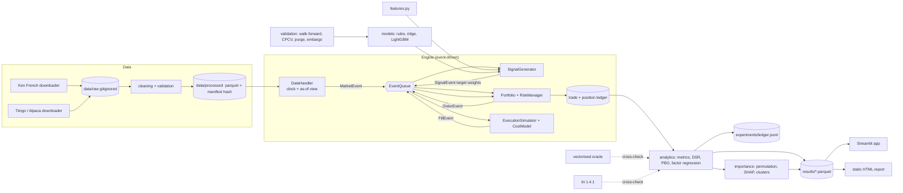

# momentum-lab: flagship project plan (Phase 2)

Status: **plan only, awaiting your approval. Nothing is implemented.**
Date: 2026-11-06. Companion files: [RESEARCH_INVENTORY.md](RESEARCH_INVENTORY.md), [TARGET_AUDIENCE.md](TARGET_AUDIENCE.md), [ROADMAP.md](ROADMAP.md) (full task table), [INTERVIEW_KIT.md](INTERVIEW_KIT.md), [LEARNING_PATH.md](LEARNING_PATH.md).

## Assumptions (stated, then I continued)

| Item | Assumed | Why |
|---|---|---|
| Original requirements | The Phase 1 research doc ("De Phase 1"; local copy [PHASE1_RESEARCH.md](PHASE1_RESEARCH.md)) | Only prior research found |
| Target roles | Primary: quant research, quant trading (research side). Secondary: data science, risk/model validation, systematic asset management | Placeholder left unfilled |
| Budget | Free tier only: free data, free hosting, free CI | Placeholder left unfilled; drops Phase 1's optional $30 tier |
| Time and skill | No limit; learns fast | Your brief |
| Language and OS | Python 3.13 on Windows (your machine) and Linux (CI) | Version constraints in RESEARCH_INVENTORY §4 |
| Folder | Repo root is `C:\Users\ASUS\Desktop\Projects\Quant Trading`; this plan lives in `docs/plan/` | Updated 2026-11-08 when the repo was set up |

Confidence tags: **High** = primary source opened (today or in Phase 1) says it directly. **Medium** = secondary source, or my inference from primary sources. **Low** = weak source. **Unverified** = my engineering judgement, no source. Sources from Phase 1 were opened on 2026-11-06 by the Phase 1 thread; sources marked "(today)" were opened by me.

---

## 1. Product definition

**Problem.** Momentum is one of the best-documented return patterns, yet most backtests of it are untrustworthy: look-ahead, survivorship, ignored costs and silent selection over many variants. The product answers one question honestly: *does vol-scaled industry momentum still earn a premium after costs, and does a machine-learning ranker add anything beyond it?*

**The product is the engine.** The strategy and feature study are the first "customers" of a small, verified, event-driven backtest engine whose design makes look-ahead impossible by construction.

**User.** (1) An interviewer probing your judgement in 10 minutes. (2) You, as a researcher who needs results you can defend. (3) Secondary: a student who wants a readable reference engine.

**MVP (core):**
1. Event-driven engine on a daily clock with data handler, signal generator, portfolio/risk, execution simulator, cost model and analytics, plus a vectorised reference oracle.
2. Verification triangle: hand-computed trade tests, synthetic known-answer markets, cross-check with bt 1.4.1.
3. Industry leg: Ken French 49 industries 1926–2026, baselines, vol-scaled 12-1 momentum, cost sweep, robustness, locked test 2006-01 to 2026-09.
4. ML leg: ridge and LightGBM rankers, walk-forward and CPCV, trial ledger with DSR, PBO and haircut Sharpe.
5. Feature study: grouped permutation importance and SHAP, stability across folds.
6. ETF leg: 9 original SPDR sector ETFs, daily, with spread, commission, borrow and capacity.
7. README, design doc, model card, coverage report, performance profile, Streamlit app with a static fallback.

**Stretch (after the cut line in §6):** CPCV path distribution in the app, numba-accelerated event loop, JKP global industry robustness (CC BY-NC data), Alpaca paper-trading shadow run, blog post, LambdaRank and monotone-constraint ablations.

**Explicit non-goals:** stock-level strategies (no free survivorship-free stock data), intraday or HFT, options, LLM or news features (look-ahead risk, Phase 1 §3), live trading with real money, deep learning models, any claim of investable performance.

**60-second demo script** (app open on the Overview page):
1. (0–10 s) "This is momentum-lab: a backtest engine I wrote and verified, used to test whether industry momentum still works after costs."
2. (10–25 s) Engine page: "Every trade is decided on data up to today's close and filled at the next close. The design makes peeking impossible, and three independent checks agree to within [x] bp a year: hand-computed trades, synthetic markets with a known answer, and the open-source bt library."
3. (25–40 s) Strategy page, drag the cost slider from 0 to 50 bp: "Here is the edge shrinking with costs. Break-even is [y] bp. Short-term reversal dies at [z] bp."
4. (40–52 s) Robustness page: "I logged all [T] configurations I tried. The deflated Sharpe ratio, which corrects for that search, is [d]." Feature page: "the ML model's importance is dominated by [group], stable in [k] of [K] folds."
5. (52–60 s) "The result I'm proudest of is the one that failed: [state the null or negative result]. Everything here is a hypothetical backtest, not advice."

---

## 2. Pre-registered success criteria

Committed as `PREREGISTRATION.md` (v1) **before** any strategy result is computed (task S-4). A v2 addendum freezes the final configurations before the locked test is opened (task T-1). Changing either after the fact is logged as a deviation in the README.

### 2.1 Hypotheses

| ID | Hypothesis (why the edge might exist) | Primary metric | What would kill it |
|---|---|---|---|
| H1 | Vol-scaled 12-1 industry momentum, long top 10 / short bottom 10 of 49, earns a positive return net of 10 bp one-way costs. Mechanism: slow diffusion of industry-wide news and investor under-reaction; risk-based stories (crash exposure) also exist ([Moskowitz & Grinblatt 1999](https://ideas.repec.org/a/bla/jfinan/v54y1999i4p1249-1290.html); [Daniel & Moskowitz 2016](https://www.nber.org/papers/w20439)). High (that the effect was documented); Medium (mechanism). | Annualised net Sharpe and Newey-West t-stat of monthly net returns | Arbitrage after publication ([McLean & Pontiff](https://academicnewsletter.sufe.edu.cn/info/359722)), crowding, costs above break-even, crash in rebounds |
| H2 | Vol scaling raises Sharpe and cuts the worst month vs unscaled 12-1 ([Barroso & Santa-Clara 2015](https://econpapers.repec.org/RePEc:eee:jfinec:v:116:y:2015:i:1:p:111-120)). High. | Sharpe difference (scaled minus unscaled), worst month | Vol forecasts failing in sudden regime shifts |
| H3 | A LightGBM ranker on 19 features beats vol-scaled 12-1 net of costs. Pre-registered expectation: **probably not by much** ([Nagel 2025](https://www.nber.org/papers/w34104)). Medium. | Net Sharpe difference with a block-bootstrap CI | Nagel's critique; overfitting; higher turnover eating the gain |
| H4 | The 1-month industry signal has a non-zero sign (two-sided: continuation or reversal). Unverified which. | Long-short return t-stat at 0 and 10 bp | Costs; it is a known liquidity effect at stock level ([Avramov et al. 2006](https://ideas.repec.org/a/bla/jfinan/v61y2006i5p2365-2394.html)) |
| H5 | In the ML model, the momentum feature group ranks first by grouped held-out permutation importance in most folds, consistent with [Gu, Kelly & Xiu 2020](https://nber.org/papers/w25398). High (their finding); the transfer to industries is Unverified. | Share of folds where momentum group ranks first | Importance spread evenly or unstable across folds |
| H6 | The edge survives on tradable sector ETFs at measured costs. Unverified. | ETF net Sharpe at measured spread + borrow | Only 9 assets; short sample; higher costs |

### 2.2 Baselines (every model must be compared to all of these, net of the same costs)

B0 cash (risk-free from Ken French daily RF); B1 equal-weight all industries, monthly rebalance; B2 published Ken French Mom factor (reference, stock-level); B3 plain 12-1 industry momentum; B4 vol-scaled 12-1; B5 1-month signal (sign chosen on research period only); B6 shuffled-label LightGBM (null model); B7 ridge regression on the same features.

### 2.3 Thresholds (set now; never promised as outcomes)

| Claim | Threshold | Notes |
|---|---|---|
| "Signal exists" (research period 1927–2005) | Newey-West t > 3.0 on net monthly returns at 10 bp ([Harvey, Liu & Zhu](https://www.nber.org/papers/w20592), High) | t between 2 and 3 is reported as "suggestive" |
| "Survives selection" | DSR ≥ 0.95 using all trials in the ledger ([Bailey & López de Prado](https://papers.ssrn.com/abstract=2460551), High); PBO < 0.5 ([Bailey et al.](https://papers.ssrn.com/abstract=2326253), High) | |
| "Holds out of sample" (locked test 2006-01 to 2026-09) | Point estimate of net Sharpe > 0 and the 90% block-bootstrap CI reported; no significance claim required | 20 years is short for a Sharpe test; Unverified judgement |
| "ML adds value" (H3) | Lower bound of 90% CI of Sharpe difference (ML minus B4) > 0 in research walk-forward **and** point estimate > 0 in test | |
| "Engine verified" | Event engine vs vectorised oracle: daily returns equal to 1e-10. Engine vs bt: annualised return within 5 bp/yr at zero cost, daily return correlation > 0.9999 | Tolerances are Unverified judgement; differences are explained, not tuned away |
| Trial budget | At most 300 logged configurations on the research period, all counted in DSR | Number is my judgement |

### 2.4 What a null or negative result looks like, and how to present it

- **H1 fails in test** (Sharpe ≤ 0 after 2006): present as "consistent with post-publication decay", show the pre/post-1993 and pre/post-2006 split, and the crash months. Headline becomes "the engine and the test design caught a decayed anomaly".
- **H3 fails** (ML ≈ vol-scaled momentum): headline "a gradient-boosted ranker rediscovers momentum; complexity added turnover, not alpha", with SHAP dependence plots showing it. This is the Nagel result and a strong interview story.
- **DSR < 0.95**: report it next to the raw Sharpe, with the trial count. Never drop trials to raise it.
- **Engine disagreement with bt** above tolerance: listed as an open issue with the decomposition (§9.3), not hidden.
- Presentation rule: each result table shows gross, net, DSR, trial count and period together. Text uses "hypothetical backtest" on every page.

---

## 3. Architecture

### 3.1 Component diagram



### 3.2 Data flow and timing (the no-look-ahead contract)

Clock = trading days from the daily panel. For each bar `t` (a trading day close):

1. `DataHandler.advance()` moves the cursor to `t` and emits `MarketEvent(t)`.
2. `Portfolio.on_market(t)` marks positions to market with returns *of day t* (positions were set before `t`).
3. If `t` is a rebalance date (last trading day of the month), `SignalGenerator.on_market` receives an `AsOfView` that can only return rows with timestamp ≤ `t`, and emits `SignalEvent(t, target_weights)`.
4. `Portfolio.on_signal` applies risk rules (vol scaling, gross/net limits) and emits `OrderEvent(t, delta_weights)` sized from positions **after** step 2.
5. `ExecutionSimulator.on_order` queues the order; fill happens at the close of the **next** bar `t+1` (`fill_lag=1`, configurable ≥ 1; 0 is forbidden for daily data). Costs are charged on traded notional at the fill.
6. `FillEvent(t+1)` updates positions; they earn returns from `t+2` onward.

How the design enforces no look-ahead:
- `AsOfView` is the only data accessor given to strategy code; it wraps a NumPy array with an integer cursor and raises `LookAheadError` on any index > cursor. There is no `.df` attribute to reach around it.
- Features are computed inside the strategy from the view, or precomputed by `features.py` with an explicit `available_at` column; `AsOfView` drops rows with `available_at > t`.
- `fill_lag ≥ 1` is validated by pydantic in config.
- Each event carries `timestamp`; the queue asserts that events are processed in non-decreasing time and that `FillEvent.timestamp > OrderEvent.timestamp`.
- Tests (§9.1): the **poisoned-future test** replaces all data after `t` with NaN and with +1000% returns and asserts that every decision up to `t` is bit-identical.

Simplification for monthly-only signals: monthly features are computed from daily returns compounded to month-ends inside the as-of view, so there is one data source and one clock.

### 3.3 Module interfaces (Python, typed; abridged)

```python
# events.py
@dataclass(frozen=True) class MarketEvent: ts: pd.Timestamp
@dataclass(frozen=True) class SignalEvent: ts: pd.Timestamp; weights: pd.Series  # index=asset, sums to gross target
@dataclass(frozen=True) class OrderEvent:  ts: pd.Timestamp; delta: pd.Series    # weight change
@dataclass(frozen=True) class FillEvent:   ts: pd.Timestamp; delta: pd.Series; cost: float; prices: pd.Series

# data.py
class DataHandler(Protocol):
    def advance(self) -> MarketEvent | None
    def view(self) -> AsOfView                      # read-only, cursor-bounded
    def bar_returns(self, ts) -> pd.Series           # returns realised on bar ts
class AsOfView:
    def returns(self, lookback: int | None = None) -> np.ndarray   # rows <= cursor
    def field(self, name: str, lookback: int | None = None) -> np.ndarray

# signals.py
class SignalGenerator(Protocol):
    def on_market(self, ev: MarketEvent, view: AsOfView) -> SignalEvent | None

# portfolio.py
class Portfolio:
    def on_market(self, ev, bar_returns) -> None      # mark-to-market, drift weights
    def on_signal(self, ev: SignalEvent) -> OrderEvent | None
    def on_fill(self, ev: FillEvent) -> None
class RiskManager(Protocol):
    def apply(self, target: pd.Series, view: AsOfView, state: PortfolioState) -> pd.Series

# execution.py
class ExecutionSimulator:
    def on_order(self, ev: OrderEvent) -> None        # queue
    def on_market(self, ev: MarketEvent, view) -> FillEvent | None  # fill due orders at this close
class CostModel(Protocol):
    def cost(self, delta: pd.Series, state: PortfolioState, view: AsOfView) -> float  # in weight units

# analytics.py
def performance(returns: pd.Series, rf: pd.Series, freq: Literal["D","M"]) -> Metrics
def deflated_sharpe(sr: float, n_obs: int, skew: float, kurt: float, sr_trials: np.ndarray) -> float
def pbo_cscv(perf_matrix: np.ndarray, n_splits: int = 16) -> float
def haircut_sharpe(sr: float, n_obs: int, n_tests: int, method: Literal["bonferroni","holm","bhy"]) -> float
def factor_regression(r: pd.Series, factors: pd.DataFrame, hac_lags: int) -> RegressionResult

# validation.py
def walk_forward_splits(dates, first_train_end, retrain_every="12M", purge="1M", embargo="1M") -> Iterator[Split]
def cpcv_splits(dates, n_groups=6, n_test_groups=2, purge="1M", embargo_pct=0.01) -> Iterator[Split]

# importance.py
def grouped_permutation_importance(model, X, y, groups: dict[str, list[str]], scorer, n_repeats=50, seed) -> pd.DataFrame
def shap_by_group(model, X_test, groups, background=None) -> pd.DataFrame
def correlation_clusters(X, threshold) -> dict[str, list[str]]
```

### 3.4 Cost model (realism)

`TotalCost = Σ_i |Δw_i| × (half_spread_i + commission + impact_i) + borrow`.
- Industry leg: flat `bps_one_way` swept over {0, 5, 10, 25, 50}; no impact (not tradable). Novy-Marx & Velikov show turnover drives net results (High).
- ETF leg: `half_spread_i` from measured quotes (task D-7) or a sweep; commission 0 (most US brokers; Unverified) plus SEC/FINRA fees ignored (Unverified, tiny); impact `= k × σ_daily × sqrt(trade_notional / ADV)` (square-root law; Unverified source, standard practice) evaluated at AUM levels $1m, $10m, $100m, $1bn; borrow fee on short notional daily at an assumed annual rate swept {25, 50, 100, 300} bp (Unverified; easy-to-borrow ETFs are usually cheap).
- Cash and financing: long-short is self-financing; collateral earns RF. Long-only variant holds no cash.
- Capacity: AUM at which impact cost equals half the gross alpha. Reported for ETFs only.

### 3.5 Why X not Y

| Choice | Chosen | Not | Why | Confidence |
|---|---|---|---|---|
| Engine style | Event-driven core + vectorised oracle | Vectorised only (Phase 1) | Brief requires event-driven; event style mirrors live systems and makes look-ahead structurally hard ([QuantStart](https://www.quantstart.com/articles/Event-Driven-Backtesting-with-Python-Part-I), today). Oracle gives an independent check and speed for sweeps | Medium |
| Clock | Daily bars, monthly rebalance | Monthly bars | Allows next-day fills, daily vol estimates, realistic drift and turnover | Unverified |
| Language | Python 3.13 | 3.12 / 3.14 | numpy and shap need ≥ 3.12; vectorbt/zipline/nautilus need < 3.15 (PyPI, today) | High (constraints) |
| Data frames | pandas 3.1 + NumPy | polars | 1.2M rows is small; sklearn, bt, statsmodels, quantstats expect pandas | Unverified |
| Env manager | uv 0.13 + `uv.lock` | conda, poetry | Fast, single lockfile, works on Windows; you can keep miniforge for other work | Medium |
| Config | YAML + pydantic v2 models, hashed | Hydra 1.3.8 | Validation (e.g. `fill_lag ≥ 1`) and a stable config hash for the ledger; Hydra's composition is not needed | Unverified |
| Experiment log | Append-only `experiments/ledger.jsonl` + git SHA + data hash | MLflow | No server, diffable, enough for ≤ 300 trials | Unverified |
| ML model | LightGBM 4.7 regression | XGBoost, neural nets | GKX: trees competitive; fast; exact TreeSHAP ([Gu, Kelly & Xiu](https://nber.org/papers/w25398)) | High (GKX) / Unverified (choice) |
| Linear benchmark | Ridge | OLS | Stable with correlated features | Unverified |
| Stats | statsmodels 0.15 (HAC/Newey-West via `cov_type="HAC"`) | hand-rolled | Standard and tested | Medium |
| Overfitting stats | Own DSR/PBO, checked against purgedcv 0.1.11 | purgedcv only | Writing them is the learning; the library is a cross-check ([PyPI](https://pypi.org/project/purgedcv/)) | High |
| Metrics cross-check | QuantStats 0.0.86 | none | Independent metric implementation | High |
| External backtester | **bt 1.4.1** (MIT) | vectorbt (Commons Clause), backtrader (GPL, last release 2023), zipline-reloaded (heavy bundle ingestion), backtesting.py (AGPL, single asset), nautilus_trader (HFT-oriented) | bt is weight-based (`WeighTarget`, `Rebalance`), multi-asset, has a `commissions` callable, MIT, released Oct 2026 (today) | High |
| App | Streamlit 1.67 on Community Cloud | Dash, Gradio on HF | Free, deploys from GitHub; HF new Gradio Spaces need a paid plan (Phase 1, High) | High |
| Fallback | Static HTML report on GitHub Pages | none | App sleeps after 12 h idle | High (sleep) |
| Testing | pytest 9 + hypothesis 6 + pytest-cov | unittest | Property tests for invariants ([Hypothesis docs](https://hypothesis.readthedocs.io/en/latest/), today) | Medium |
| Profiling | pyinstrument 5.1 | cProfile only | Readable call-tree HTML for the profile artefact | Unverified |

### 3.6 Design doc deliverable

`docs/DESIGN.md` in the repo (2–3 pages): the timing contract (§3.2) with a sequence diagram, interfaces, invariants, the verification triangle, known limitations.

### 3.7 Performance profile deliverable

`make profile` runs the full 1926–2026 daily backtest under pyinstrument and writes `reports/profile.html` plus a table: wall time, bars per second, peak memory (`tracemalloc`), time share per component. Target: under 30 s per full backtest on your laptop (Unverified). If it misses, optimise the hot loop (NumPy arrays instead of Series inside events; numba is stretch) and show before/after.

---

## 4. Repository blueprint

```
momentum-lab/
├── README.md                 results-first summary, app link, reproduce commands
├── PREREGISTRATION.md        v1 hypotheses/thresholds; v2 frozen configs (git-tagged)
├── MODEL_CARD.md             strategy/model card (SR 26-2 spirit)
├── LICENSE                   MIT for code; data not included
├── pyproject.toml            deps, ruff, mypy, pytest config
├── uv.lock                   pinned environment
├── .python-version           3.13
├── Makefile                  task runner (also a tasks.py for Windows, see below)
├── .github/workflows/ci.yml  lint, type-check, tests, coverage on synthetic data
├── configs/
│   ├── base.yaml             universe, dates, costs, seeds, fill_lag
│   ├── strategies/*.yaml     one file per strategy config
│   └── sweeps/*.yaml         parameter grids (count toward trial budget)
├── data/                     gitignored: raw/, interim/, processed/; manifest.json committed (hashes, URLs, dates)
├── src/momlab/
│   ├── config.py             pydantic models, config hashing
│   ├── events.py             event dataclasses
│   ├── queue.py              EventQueue with time-order assertions
│   ├── data/
│   │   ├── kenfrench.py      download + parse zip CSVs, -99.99/-999 → NaN
│   │   ├── etf.py            Tiingo/Alpaca downloader, adjusted prices, volume
│   │   ├── clean.py          validation rules (§5.3)
│   │   ├── handler.py        DataHandler, AsOfView, test-vault masking
│   │   └── calendar.py       trading days, month-end rebalance dates
│   ├── features.py           19 features with available_at
│   ├── signals/
│   │   ├── rules.py          momentum, vol-scaled momentum, 1-month signal, equal weight
│   │   └── model_signal.py   wraps a fitted model as a SignalGenerator
│   ├── portfolio.py          positions, drift, PortfolioState
│   ├── risk.py               vol targeting, gross/net/position caps
│   ├── execution.py          ExecutionSimulator, fill_lag
│   ├── costs.py              FlatBps, SpreadImpactBorrow
│   ├── engine.py             event loop, run(config) -> RunResult
│   ├── oracle.py             vectorised reference implementation
│   ├── analytics/
│   │   ├── metrics.py        Sharpe, Sortino, MDD, Calmar, turnover, HAC t
│   │   ├── overfitting.py    PSR, DSR, PBO (CSCV), haircut Sharpe
│   │   ├── factors.py        FF + Mom + ST Rev regressions
│   │   └── bootstrap.py      stationary block bootstrap
│   ├── validation.py         walk-forward, CPCV, purge, embargo
│   ├── models.py             ridge, LightGBM, shuffled-label null
│   ├── importance.py         clusters, grouped permutation, SHAP
│   ├── ledger.py             append-only trial ledger
│   └── synthetic.py          known-answer market generators
├── tests/
│   ├── unit/                 per-module tests (§9.1)
│   ├── property/             hypothesis invariants
│   ├── synthetic/            known-answer markets (§9.2)
│   ├── crosscheck/           oracle, bt, quantstats, purgedcv parity (§9.3)
│   └── regression/           golden results (§9.4)
├── experiments/ledger.jsonl  every trial (committed)
├── results/                  small parquet/CSV outputs used by app and README
├── reports/                  coverage html, profile html, figures
├── notebooks/                exploration only; nothing in results/ comes from notebooks
├── app/
│   ├── streamlit_app.py
│   └── pages/                1_Engine, 2_Strategy, 3_Robustness, 4_Features, 5_Crashes, 6_Ledger
└── docs/
    ├── DESIGN.md, DATA.md, DECISIONS.md (decision log), LIMITATIONS.md
    └── plan/                 this plan
```

- **Pinned environment:** `uv lock`; CI uses `uv sync --frozen`. Python pinned via `.python-version`.
- **Config system:** `configs/base.yaml` merged with a strategy YAML into a pydantic `RunConfig`; `config_hash = sha256(canonical JSON)`. Every result file name includes the hash.
- **Seeds:** one `seed` in config; derived seeds via `numpy.random.SeedSequence(seed).spawn(n)` for bootstrap, permutation, LightGBM (`seed`, `deterministic=True`, `num_threads` fixed).
- **Task runner:** Makefile targets `setup, data, test, test-fast, lint, typecheck, crosscheck, results, robustness, importance, report, profile, app, all`. Because you are on Windows, also provide `tasks.py` (plain Python, `python tasks.py test`) with the same targets so `make` is optional.
- **CI** (`ci.yml`, GitHub Actions, free on public repos): on push and PR: `uv sync --frozen` → `ruff check` → `ruff format --check` → `mypy src` → `pytest -m "not data" --cov=momlab --cov-fail-under=85` → upload coverage HTML as an artefact. Real-data tests are marked `data` and run locally (raw data cannot be committed).

---

## 5. Data plan

### 5.1 Sources and licences

| Dataset | Use | Coverage | Licence / terms | Confidence |
|---|---|---|---|---|
| Ken French 49 Industry Portfolios, daily and monthly (value-weighted block primary) | Industry leg | 1926-07-01 to 2026-09-30 | Copyright Fama & French; no licence stated. Download in code; do not commit raw files; publish derived results with attribution | High (coverage, copyright); Unverified (policy) |
| Ken French F-F 3 factors daily/monthly (incl. RF), Mom, ST Rev | RF, factor regressions, B2 | Long history | Same | High |
| Tiingo EOD (free tier) | ETF prices, adjusted, volume | ETFs since 1998-12 | Free tier limits and "internal use" terms per Phase 1 (Medium); verify at sign-up | Medium |
| Alpaca Market Data Basic (free) | ETF cross-check, quotes for spread estimate | Since 2016, IEX feed | Free; per Phase 1 (High) | High |
| yfinance | Emergency fallback only | Broad | "Personal use only" (Phase 1, High) | High |

ETF universe: the nine original Select Sector SPDRs (XLB, XLE, XLF, XLI, XLK, XLP, XLU, XLV, XLY), which all trade from December 1998 (Unverified date; check in D-6). XLRE and XLC are excluded from the core test (start 2015 and 2018; Unverified) to keep the universe fixed.

### 5.2 Schema (processed, long format parquet)

`industry_daily.parquet`: `date: date32`, `asset: category(49)`, `ret: float64` (simple, decimal), `weighting: {"vw","ew"}`, `available_at: date32` (= date), `n_firms: int` (monthly, forward-filled within month, lagged one month), `avg_size: float` (same), `source_vintage: str`.
`factors_daily.parquet`: `date, mkt_rf, smb, hml, rf, mom, st_rev`.
`etf_daily.parquet`: `date, asset, open, close, adj_close, volume, ret (from adj_close), available_at`.
`etf_quotes_sample.parquet`: `date, asset, bid, ask, mid, half_spread_bps`.
`features_monthly.parquet`: `date (month-end t), asset, f_* (16 columns), available_at, label_fwd_1m (demeaned), label_window_end`.
`manifest.json`: per file `url, download_ts, sha256, rows, first_date, last_date`.

### 5.3 Cleaning rules (each one a test)

1. Replace -99.99 and -999 with NaN; percent → decimal.
2. Assert dates strictly increasing, unique, trading days only; monthly dates parse to month-end.
3. An industry with NaN return on day t is excluded from the cross-section for any rebalance whose lookback includes NaNs (no forward-fill of returns, ever).
4. Daily-compounded month returns must match the monthly file within 1e-4 per industry-month; mismatches logged (vintage or rounding).
5. Values outside [-0.5, +1.0] daily get flagged for review, not clipped.
6. ETF: returns from adjusted close; check splits by comparing to unadjusted ratio; drop days with zero volume.
7. Data vintage: Ken French files are revised over time (CRSP updates; Unverified). Store the sha256 and download date; results cite the vintage.

### 5.4 Split design

- **Research period:** 1926-07 to 2005-12 (features need 12 months, so first signal 1927-07). All exploration, tuning and the trial budget live here.
- **Locked test:** 2006-01 to 2026-09. The `DataHandler` masks these rows unless `MOMLAB_UNLOCK_TEST=1` **and** `PREREGISTRATION.md` v2 is committed and tagged `prereg-v2`. Unlocking appends an entry to `experiments/unlock_log.jsonl`. Opened once (task T-2).
- **ML inside the research period:** expanding-window walk-forward, first training window 1927-07 to 1946-12, retrain every 12 months, predictions 1947-01 to 2005-12. Purge 1 month plus 1 day (label horizon plus fill lag) and embargo 1 month. CPCV: 6 groups, 2 test groups → 15 splits and 5 backtest paths ([López de Prado 2018, ch. 12](https://www.wiley-vch.de/de/fachgebiete/finanzen-wirtschaft-recht/advances-in-financial-machine-learning-978-1-119-48208-6), High).
- **Sub-periods (reporting only):** 1927–1945, 1946–1969, 1970–1992, 1993–2005, 2006–2026; pre/post 1993 publication split.
- **ETF leg:** 1999-01 to 2026-09 run once with the frozen industry strategy (no ETF tuning).

### 5.5 Leakage and bias checklist (project-specific)

| # | Risk | Check | Test |
|---|---|---|---|
| L1 | Signal uses day t return and fills at day t close | `fill_lag ≥ 1` validator | poisoned-future test |
| L2 | 12-1 window off by one (includes the skip month) | Hand-computed window on a 15-month toy series | `test_mom_12_1_window` |
| L3 | Monthly n_firms / avg_size used in the same month it is reported | Lag one month via `available_at` | `test_available_at_lag` |
| L4 | BE/ME (if used) available before fiscal data is public | Use only from July of year t+1; excluded from core features | `test_beme_lag` |
| L5 | Cross-sectional demeaning of the label uses assets missing at t | Demean over assets valid at t only | `test_label_universe` |
| L6 | Feature standardisation fit on all data | Scalers fit inside each training fold | `test_scaler_in_fold` |
| L7 | Overlapping labels across CV folds | Purge and embargo | `test_purge_removes_overlap` |
| L8 | Hyperparameters chosen on the test period | Test vault masking | `test_vault_locked` |
| L9 | Vol-scaling uses the same day's realised vol | Vol from returns ≤ t | covered by poisoned-future test |
| L10 | Survivorship | Industry portfolios include all CRSP firms at the time; ETFs fixed list chosen on inception dates, not on performance | documented in DATA.md |
| L11 | Look-ahead in industry definitions | Ken French assigns SIC at end of June t (point-in-time per detail page, High) | documented |
| L12 | Selection bias from my own trials | Ledger + DSR + PBO | `test_ledger_append_only` |
| L13 | Data-snooping via prior knowledge (I already know momentum crashed in 2009) | Pre-registration before looking; crash analysis is descriptive | process |
| L14 | ETF universe chosen with hindsight | Fixed rule: the nine original sector SPDRs | process |

---

## 6. Phased roadmap (summary; full task table in [ROADMAP.md](ROADMAP.md))

| Phase | Goal | Entry | Exit |
|---|---|---|---|
| P0 Setup & pre-registration | Repo, env, CI, PREREG v1 | Plan approved | CI green on an empty test; PREREG v1 tagged |
| P1 Data | Clean, hashed panels | P0 | All §5.3 tests pass; D-4 gate (own 12-1 vs Mom correlation) passes |
| P2 Engine | Event-driven engine + oracle | P1 | Hand-computed trade tests pass; engine == oracle to 1e-10 |
| P3 Verification | Synthetic markets, bt and QuantStats parity, profile | P2 | All §9.2/§9.3 checks pass or differences documented |
| P4 Baselines & rules research | B0–B5, sweeps, cost curve | P3 | Baseline table on research period; ledger populated |
| P5 ML & feature study | Ridge, LightGBM, null, importance | P4 | Walk-forward and CPCV results; importance stability report |
| P6 Robustness & locked test | Surfaces, sub-periods, multiple testing, PREREG v2, unlock, ETF leg | P5 | Final tables with DSR, PBO, CI; test opened once |
| P7 Product | README, DESIGN, MODEL_CARD, app, static report, interview kit numbers | P6 | App live; README reproducible from `make all` |
| ---- cut line: core above, stretch below ---- | | | |
| P8 Stretch | numba loop, CPCV path viewer, JKP robustness, paper-trading shadow, blog | P7 | Each item independent |

**Critical path:** S-1 → S-2 → S-4 → D-1 → D-2 → D-3 → D-4 → E-1 → E-2 → E-3 → E-4 → E-5 → E-6 → V-1 → V-3 → R-1 → R-2 → M-1 → M-3 → M-4 → F-1 → F-2 → B-1 → B-3 → T-1 → T-2 → W-1 → A-1.

---

## 7. Method plan

### 7.1 Order of work
1. **Baselines first** (B0–B5) on the research period at 0 and 10 bp, with turnover.
2. **Rule progression:** plain 12-1 (B3) → vol-scaled (B4: target 10% annual vol, vol from trailing 126 trading days of strategy returns, leverage cap 2.0; window is Unverified, see inventory gap 6) → crash-aware variant (scale down when the past 24-month market return is negative and market vol is high, after [Daniel & Moskowitz](https://www.nber.org/papers/w20439); High that the conditions predict crashes, Unverified as a rule).
3. **ML progression:** ridge (B7) → LightGBM regression → LightGBM with monotone constraint on momentum features (stretch) → LambdaRank ablation (stretch). Shuffled-label null (B6) runs with every ML config.
4. **Portfolio mapping identical for all signals:** rank the score, long top 10, short bottom 10, equal weight within legs, then the same vol-targeting risk rule. Only the score differs, so comparisons isolate the signal.

### 7.2 Features (19, in 5 groups; all computed from data ≤ t)

| Group | Features |
|---|---|
| Momentum | `mom_12_1`, `mom_6_1`, `mom_3_1`, `mom_36_13` (long-term), `mom_12_1_riskadj` (= mom_12_1 / vol_12m) |
| Short-term | `ret_1m`, `max_daily_1m` (largest daily return last month), `frac_up_days_1m` |
| Volatility / risk | `vol_1m`, `vol_3m`, `vol_12m`, `beta_12m` (vs market), `downside_vol_3m` |
| Structure (size proxy) | `log_avg_size` (lagged 1 month), `n_firms` (lagged), `vw_minus_ew_12m` |
| Market state (same for all assets in a month) | `mkt_ret_24m`, `mkt_vol_1m`, `xs_dispersion_1m` |

The market-state group is identical across assets in a month, so it only matters through interactions in trees; it is still one group for importance. Liquidity is not available at industry level (inventory C5).

Label: `y = r_{i,t+1} − mean_j r_{j,t+1}`, where the return window runs from the fill close (t+1 trading day) to the next fill close. LightGBM defaults pre-registered: `num_leaves=15, learning_rate=0.03, n_estimators=300, min_data_in_leaf=200, feature_fraction=0.8, bagging_fraction=0.8, lambda_l2=1.0`; tuning only via the inner time-series split and counted in the trial budget. Scorer: mean monthly Spearman rank IC.

### 7.3 Ablations
- Drop each feature group (5 runs) → change in rank IC and net Sharpe.
- Momentum-only LightGBM vs all features (Nagel test on real data).
- No vol scaling vs vol scaling, for both rules and ML.
- Fill lag 1 vs 2 vs 5 days.
- Value-weighted vs equal-weighted industry returns.
- Long-short vs long-only (top 10 vs B1).

### 7.4 Sensitivity analyses (research period only)
- Parameter stability surface: lookback {3, 6, 9, 12, 18} months × skip {0, 1} × holding {1, 3, 6} months (overlapping portfolios for holding > 1) × n per leg {5, 7, 10, 15}: heatmaps of net Sharpe at 10 bp. Pass condition: the pre-registered point (12, 1, 1, 10) sits on a plateau, defined as ≥ 70% of its neighbours within 0.2 Sharpe (Unverified rule).
- Cost sweep {0, 5, 10, 25, 50} bp and break-even cost.
- Vol target {5, 10, 15}% and window {63, 126, 252} days.
- Rebalance day: last trading day vs 10th trading day of month.

### 7.5 Experiment log schema (`experiments/ledger.jsonl`, one JSON object per trial)

```json
{"trial_id": "uuid4", "ts": "ISO-8601", "git_sha": "abc123", "dirty": false,
 "config_hash": "sha256", "config": {...}, "data_manifest_hash": "sha256",
 "phase": "research|test", "strategy": "vs_mom_12_1", "family": "rules|ml|null",
 "period": ["1927-07-31", "2005-12-31"], "cost_bps": 10, "seed": 7,
 "metrics": {"ann_ret": 0.0, "ann_vol": 0.0, "sharpe": 0.0, "sharpe_hac_t": 0.0,
             "sortino": 0.0, "mdd": 0.0, "calmar": 0.0, "worst_month": 0.0,
             "skew": 0.0, "kurt": 0.0, "turnover_1way_monthly": 0.0,
             "rank_ic_mean": null, "rank_ic_t": null, "n_months": 0},
 "counts_toward_budget": true, "notes": "why I ran this"}
```
`ledger.py` refuses to rewrite or delete lines (append-only, checked by a hash chain: each line stores the sha256 of the previous line).

---

## 8. Honesty and robustness protocol

### 8.1 Ten ways this project could fool me, and the test that catches each

| # | Self-deception | Catching test |
|---|---|---|
| 1 | Hidden look-ahead in engine or features | Poisoned-future test; `AsOfView` bounds; fill_lag validator; engine vs oracle vs bt |
| 2 | Off-by-one in signal windows | Hand-computed toy windows; correlation of own B3 with published Mom > 0.5 (debug stop < 0.3; thresholds Unverified) |
| 3 | Selection over hundreds of variants | Append-only ledger; DSR with all trials; PBO via CSCV; Harvey-Liu BHY haircut ([Harvey & Liu, today](https://people.duke.edu/~charvey/Research/Published_Papers/P120_Backtesting.PDF)) |
| 4 | Peeking at the test period | Vault masking + unlock log + PREREG v2 tag |
| 5 | ML "skill" from leakage | Shuffled-label null must have |Sharpe| small and rank IC ≈ 0; purged CV; scaler-in-fold test |
| 6 | Costs ignored or understated | Cost curve and break-even; turnover reported; ETF measured spreads; borrow sweep |
| 7 | Overstated Sharpe from autocorrelation or annualisation | Lo (2002) adjustment for serial correlation ([IDEAS, today](https://ideas.repec.org/a/taf/ufajxx/v58y2002i4p36-52.html)); HAC t-stats; block bootstrap CI |
| 8 | One lucky period carries everything | Sub-period table; rolling 10-year Sharpe chart; leave-one-decade-out |
| 9 | ML is momentum in disguise | Momentum-only model vs full; SHAP dependence on mom_12_1; correlation of ML returns with B4 returns; synthetic reversal market (§9.2 S4) |
| 10 | Importance read as causation or as stable truth | Grouped permutation on held-out folds with CIs; rank stability across folds (Kendall τ); SHAP interventional vs path-dependent comparison; caveats in §7 report |

### 8.2 Finance-awareness items

- **Costs:** industry leg is a sweep because portfolios are not tradable; ETF leg uses measured spreads. Momentum's costs at scale are lower than academic estimates while reversal's are not ([Frazzini, Israel & Moskowitz, today](https://www.aqr.com/Insights/Research/Working-Paper/Trading-Costs-of-Asset-Pricing-Anomalies), High).
- **Regimes:** crash months (1932, 2009 rebound) analysed explicitly; bear-market state feature ([Daniel & Moskowitz](https://www.nber.org/papers/w20439), High).
- **Regulation:** all outputs labelled "hypothetical backtest, not investment advice"; no performance marketing ([Phase 1 §3](https://www.klgates.com/thought-leadership/Hypothetical-Performance-Crackdown-Nine-Firms-Charged-With-Violations-of-Investment-Adviser-Marketing-and-Recordkeeping-Rules-9-13-2023), Medium). Data terms respected (no raw redistribution).
- **Model risk:** MODEL_CARD.md follows the spirit of [SR 26-2](https://www.federalreserve.gov/supervisionreg/srletters/sr2602.htm) (High): purpose, data, conceptual soundness, outcomes analysis, limits, monitoring triggers.
- **Capacity:** ETF capacity curve at AUM $1m to $1bn; industry leg has no capacity claim.
- **Data quality:** vintage hashes; monthly vs daily reconciliation; 1926–1940s industries with few firms flagged (n_firms) and a robustness run excluding industries with < 5 firms (threshold Unverified).
- **Borrow:** ETF shorts are generally easy to borrow but not free; swept, and long-only variant reported (Unverified).

---

## 9. Test strategy

### 9.1 Unit tests for silent-bug-prone functions

| Function | Test (hand-computed expected values in the test file) |
|---|---|
| `features.mom_window` | 15-month toy series of known returns; assert `mom_12_1` = product of months t-12…t-2 minus 1; skip month excluded |
| `calendar.month_end_rebalance_dates` | Months ending on weekends/holidays (e.g. 2023-09-29 Friday) |
| `portfolio.on_market` (drift) | 2 assets, weights 0.5/0.5, returns +10%/−10% → weights 0.55/0.45 after drift |
| `portfolio.turnover` | Turnover computed from drifted weights, not from previous targets |
| `costs.FlatBps` | Δw = [+0.2, −0.2] at 10 bp → cost 0.0004 |
| `execution` fill lag | Order at t fills at t+1 close; returns credited from t+2 |
| Hand-computed trades | 3 assets × 6 days spreadsheet (committed as CSV): every fill, cost, position and daily P&L matches to 1e-12 |
| `risk.vol_target` | Constant-vol synthetic returns → leverage = target/vol; cap respected |
| `analytics.sharpe` | Known series; RF subtraction; annualisation √252 vs √12 matches frequency |
| `analytics.max_drawdown` | Hand example with two drawdowns |
| `overfitting.psr/dsr` | Reproduce numeric example from Bailey & López de Prado; match purgedcv |
| `overfitting.pbo_cscv` | Matrix where one strategy dominates in every split → PBO ≈ 0; pure noise → PBO ≈ 0.5 |
| `validation.purge` | No training label window overlaps any test label window |
| `importance.grouped_permutation` | Permuting a group shuffles all its columns with the same row permutation |
| `kenfrench.parse` | Fixture text with -99.99, -999 and header blocks parses to NaN and decimals |
| Property tests (hypothesis) | Zero-cost run is invariant to asset column order; weights sum to target gross; cost ≥ 0; doubling all target weights doubles gross P&L |

### 9.2 Synthetic markets with a known answer (`tests/synthetic/`)

- **S1 Null market:** 49 i.i.d. Student-t assets, 30 years, 200 seeds. Expect: momentum Sharpe |t| > 2 in about 5% of seeds (binomial check), mean Sharpe ≈ 0.
- **S2 Planted momentum:** monthly returns `r_{i,t+1} = β · z(mom_12_1_{i,t}) + ε`, β known. The expected long-short monthly return is derivable from β and the spread in z between legs; the engine's estimate over 100 years must fall within its 95% CI in ≥ 90% of 50 seeds.
- **S3 Deterministic cost market:** constant returns, alternating signal; P&L equals −(turnover × cost) exactly.
- **S4 Planted reversal (Nagel-style):** returns reverse the 12-1 signal. Expect momentum loses money and LightGBM learns a negative dependence (SHAP slope on mom_12_1 < 0).

### 9.3 Cross-checks (independent implementations)

1. **Oracle:** `oracle.py` vectorised path; daily returns identical to 1e-10 for all baselines at any cost.
2. **bt 1.4.1:** convert returns to price indices; pass engine target weights **shifted to the fill date** to `bt.algos.WeighTarget` + `bt.algos.Rebalance`; `commissions=lambda q, p: abs(q) * p * bps / 1e4`; `integer_positions=False`. Expected sources of difference, each quantified in `reports/crosscheck.md`: (a) bt trades at the close of the bar where weights appear (handled by the shift), (b) bt's commission is in cash and reduces capital before sizing (Medium; read from bt source today), (c) cash residuals, (d) floating-point. Pass: tolerance in §2.3.
3. **QuantStats:** Sharpe, Sortino, max drawdown, CAGR on the same return series within 1e-6 (definitions aligned: RF, periods).
4. **purgedcv:** DSR and PBO values within 1e-6 on the same inputs.
5. **Ken French Mom factor:** correlation and regression of own 12-1 industry momentum on published Mom (sanity, not equality: different universes).

### 9.4 Regression tests on results

- `tests/regression/golden_synthetic.parquet`: metrics of every baseline on a seeded synthetic market; CI fails if any metric changes by > 1e-9 unless `GOLDEN_UPDATE` is set and the change is explained in `docs/DECISIONS.md`.
- `make regress` (local, needs real data): compares baseline metrics on the frozen data vintage against `results/golden_real.json`.
- Coverage: ≥ 85% lines for `src/momlab` (Unverified target), 100% for `engine.py`, `execution.py`, `costs.py`, `data/handler.py`.

---

## 10. Deployment

**Stack:** Streamlit 1.67 app on Streamlit Community Cloud, reading only `results/*.parquet` (target < 50 MB total, Unverified), no data downloads at runtime. Fallback: static HTML report (`make report`, matplotlib + Jinja2 into `site/`) on GitHub Pages.

**Steps:**
1. Make the repo public on GitHub (required for free CI minutes and Pages; private repos get $12/month of compute, [GitHub docs](https://docs.github.com/en/billing/concepts/product-billing/github-actions), High).
2. `make results report` locally; commit `results/` and `site/`.
3. Add `app/requirements.txt` exported from the lockfile (`uv export --no-dev > app/requirements.txt`).
4. On share.streamlit.io: New app → repo → branch `main` → file `app/streamlit_app.py` → Python 3.13 in advanced settings → Deploy.
5. Settings → Pages: deploy `site/` via a `pages.yml` workflow.
6. Smoke test: open each page in a private window; memory stays under 1 GB (Unverified target, well under 2.7 GB).

**Free-tier limits:** 0.078–2 cores, 690 MB–2.7 GB RAM, sleeps after 12 h without traffic, limits "may change at any time" ([Streamlit docs, today](https://docs.streamlit.io/deploy/streamlit-community-cloud/manage-your-app), High). Mitigation: `st.cache_data` on loaders; visit the app before each interview; README links both app and static report.

**What the live app shows:** Overview (question, headline table with gross/net/DSR/trials/period, hypothetical label); Engine (timing diagram, cross-check table, coverage badge, profile); Strategy (equity curves, cost slider recomputing `net = gross − cost × turnover` from stored series, long-short vs long-only); Robustness (parameter heatmaps, sub-periods, DSR/PBO, rolling Sharpe); Features (grouped importance with CIs, fold stability, SHAP summary and dependence); Crashes (worst 10 months, market-state conditions, what vol scaling saved); Ledger (filterable trial table).

---

## 11. Documentation

**README outline:** 1) one-paragraph result with numbers, CIs, trials and "hypothetical backtest" label; 2) app and report links, one figure (cost curve); 3) question and pre-registered hypotheses (link PREREG); 4) engine in 5 bullets plus verification table; 5) data and licences; 6) method (timing, costs, validation); 7) results table (all baselines, gross and net, DSR, PBO); 8) feature study summary; 9) what failed; 10) limitations (link); 11) reproduce: `uv sync && python tasks.py all`; 12) project structure; 13) references.

**Strategy/model card (`MODEL_CARD.md`):** purpose and intended use (research demo only); not intended for (live trading, advice); data and vintage; methodology; assumptions (fill lag, costs, borrow); validation (verification triangle, CV, test); performance with uncertainty; known limitations; sensitivity; monitoring triggers if it were live (rolling 36-month Sharpe < 0, turnover > 2× research average, rank IC < 0 for 12 months; Unverified thresholds); owner and date.

**Limitations section (`docs/LIMITATIONS.md`):** industry portfolios not tradable; single country; Ken French data revisions; no liquidity features; ETF sample short (9 assets, ~27 years); cost model simplified; borrow assumed; 20-year test is a short sample for Sharpe inference; DSR depends on honest trial counting; importance is model-specific and not causal.

**Results tables and figures:** T1 baselines (research); T2 ML vs rules; T3 locked test; T4 sub-periods; T5 factor regression (alpha, betas, HAC t); T6 cross-check; T7 ETF leg with capacity. F1 cumulative net returns (log scale); F2 cost curve; F3 parameter heatmap; F4 rolling 10-year Sharpe; F5 grouped importance with CIs; F6 importance rank stability across folds; F7 SHAP dependence of mom_12_1; F8 crash months; F9 engine timing sequence diagram; F10 profile breakdown.

**Optional blog post outline:** "I tried to fool myself ten ways with a momentum backtest": hook (the result that failed) → why momentum → the engine contract → the three checks → results with costs → ML vs momentum → what importance means and doesn't → lessons.

---

## 12. Interview kit (summary; full kit in [INTERVIEW_KIT.md](INTERVIEW_KIT.md))

Contains: 3 CV bullet templates with blanks; 25 probing questions with answer outlines; 5 weaknesses to disclose proactively; 3-minute and 10-minute talk tracks.

## 13. Learning path (summary; full path in [LEARNING_PATH.md](LEARNING_PATH.md))

16 concepts ordered by when the roadmap needs them, each with primary resources and a self-check exercise.

---

## 14. Risk register

| # | Risk | Early warning | Mitigation | Fallback |
|---|---|---|---|---|
| R1 | Hidden look-ahead | Sharpe > 2 on monthly data; null model profitable; engine ≠ oracle | Poisoned-future test, triangle checks | Freeze results; bisect by git SHA |
| R2 | Ken French download or format changes | Parser test fails on new vintage | Fixture tests; manifest hashes; keep last good local copy | pandas-datareader 0.11.1 as alternate parser |
| R3 | Free ETF data tier changes or blocks | 401/429 errors | Cache locally, small universe (9) | Alpaca Basic; yfinance for personal verification only |
| R4 | Momentum fails in locked test | (unknown until T-2) | Pre-registered null presentation (§2.4) | Story pivots to decay and engine rigour |
| R5 | ML adds nothing | Rank IC of ML ≈ ridge ≈ B4 | Pre-registered as likely (H3) | Nagel framing |
| R6 | Scope creep / never shipping | Stretch tasks started before P7 exit | Cut line; P7 before P8 | Ship core only |
| R7 | Trial budget exhausted early | Ledger count > 200 before P5 | Plan sweeps in configs; count before running | Report DSR with full count anyway |
| R8 | Engine too slow for sweeps | Full run > 60 s | Profile; oracle for sweeps after parity is proven | numba (stretch) |
| R9 | bt cross-check disagrees | Gap > tolerance | Decompose by cause (§9.3) | Document as known difference with evidence |
| R10 | App down during an interview | Sleep, memory errors | Precomputed small files; visit before | Static GitHub Pages report and README figures |

## 15. Execution brief (paste into the build prompt)

```
1. Build "momentum-lab": event-driven daily-clock backtest engine (DataHandler/AsOfView, SignalGenerator, Portfolio+Risk, ExecutionSimulator fill_lag>=1, CostModel, analytics) + vectorised oracle, Python 3.13, uv, pydantic configs, pytest+hypothesis, CI.
2. Data: Ken French 49 industries daily/monthly 1926-07..2026-09 + FF factors, Mom, ST Rev (download in code, never commit raw); 9 original SPDR sector ETFs from Tiingo free/Alpaca.
3. Pre-register H1-H6, baselines B0-B7, thresholds (t>3, DSR>=0.95, PBO<0.5), trial budget 300 BEFORE any results; PREREG v2 before unlocking 2006-01..2026-09.
4. Verify engine: hand-computed 3x6 trade CSV, poisoned-future test, synthetic null/planted-momentum/cost/reversal markets, oracle 1e-10, bt 1.4.1 within 5 bp/yr, QuantStats and purgedcv parity.
5. Strategy: vol-scaled 12-1 industry momentum, top10/bottom10, 10% vol target; 1-month signal two-sided; cost sweep 0-50 bp.
6. ML: ridge then LightGBM regression on 19 features (5 groups), demeaned next-month label, expanding walk-forward from 1947 with purge+embargo, CPCV 6/2, shuffled-label null.
7. Feature study: correlation clusters, grouped held-out permutation importance (50 repeats, CIs), SHAP interventional vs tree-path, Kendall tau stability across folds, Nagel momentum-only test.
8. Robustness: parameter heatmaps (plateau rule), sub-periods, fill-lag and vol-window sensitivity, Lo-adjusted Sharpe, HAC t, block bootstrap, Harvey-Liu BHY haircut.
9. Append-only hash-chained experiments/ledger.jsonl for every trial; DSR uses all trials.
10. Ship: README results-first, DESIGN.md, MODEL_CARD.md, LIMITATIONS.md, coverage+profile reports, Streamlit app + static Pages fallback; label everything "hypothetical backtest".
```
